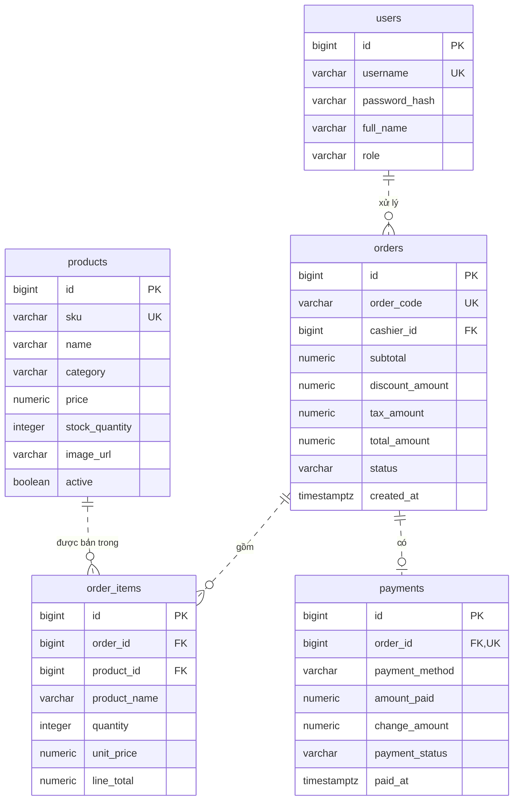
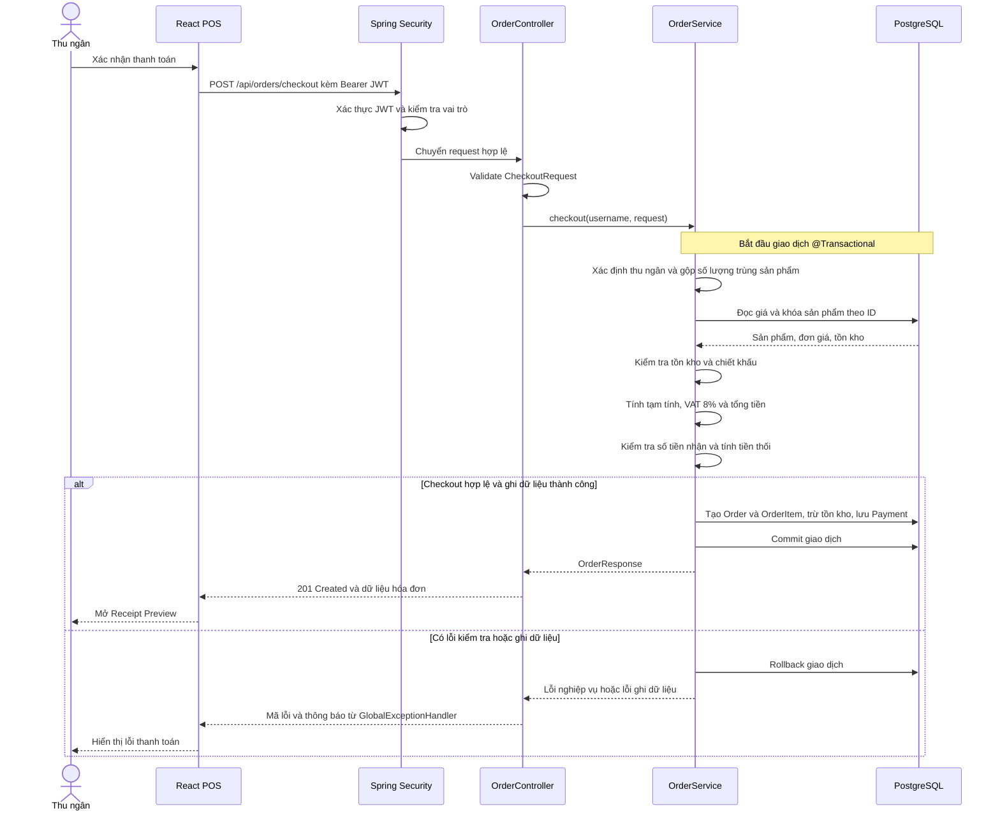
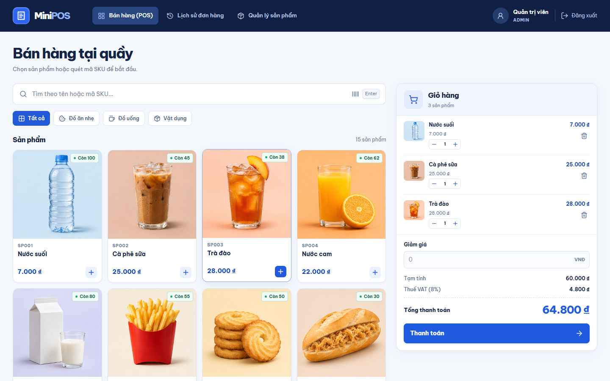
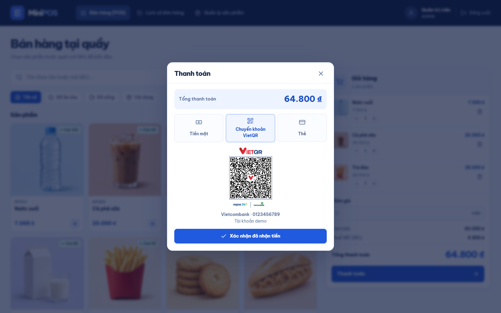
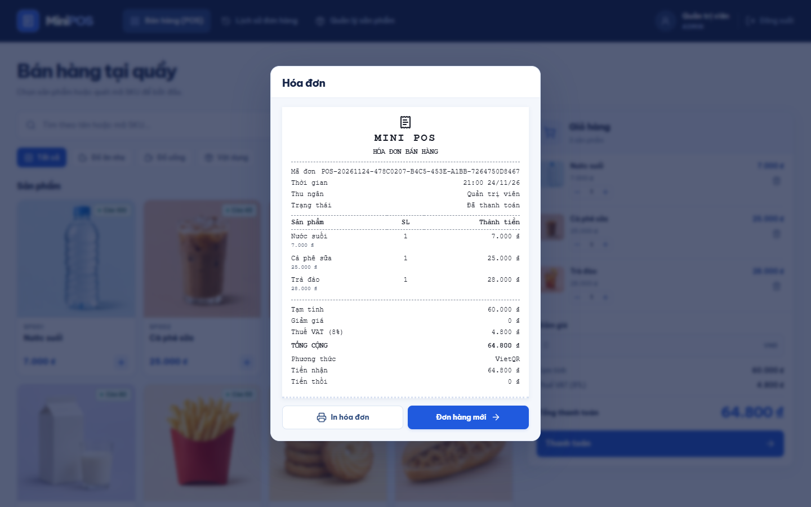
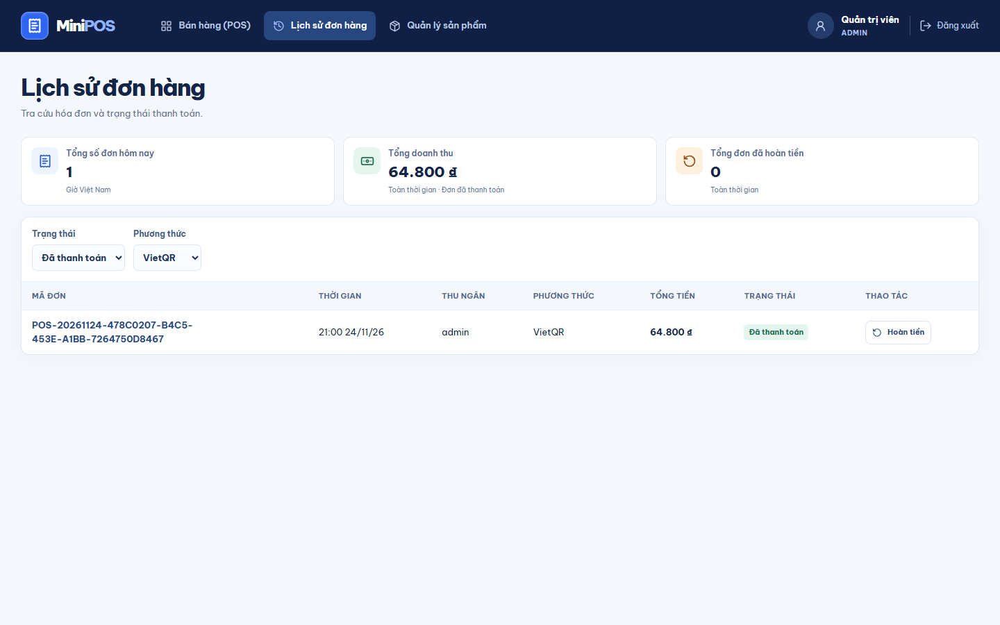

# Mini POS & Payment System

Mini POS là ứng dụng bán hàng tại quầy cho cửa hàng nhỏ. Thu ngân tìm sản phẩm hoặc nhập SKU như khi quét mã vạch, tạo giỏ hàng và in hóa đơn. Quản trị viên theo dõi giao dịch, quản lý tồn kho và xử lý hoàn tiền.

## Giới thiệu và tính năng nổi bật

- **Thanh toán đa phương thức.** Tiền mặt tính tiền thối, VietQR hiển thị mã theo tổng hóa đơn và cho phép thu ngân xác nhận đã nhận tiền, còn Thẻ mô phỏng thao tác quẹt thẻ. VietQR dùng tài khoản demo và phần hoàn tiền ghi nhận trong hệ thống POS.
- **Xác thực và phân quyền.** Spring Security xác thực JWT và mật khẩu được băm bằng BCrypt. `CASHIER` có thể bán hàng và xem lịch sử. `ADMIN` có thêm quyền quản lý sản phẩm và hoàn tiền.
- **Tính tiền tại server.** Backend lấy đơn giá từ PostgreSQL, lưu tên và đơn giá tại thời điểm bán, sau đó tính VAT 8% trên số tiền sau giảm giá.
- **Checkout nhất quán.** `@Transactional` gom việc tạo đơn, ghi thanh toán và trừ kho trong một giao dịch. Khóa ghi bi quan (`PESSIMISTIC_WRITE`) theo thứ tự ID sản phẩm giúp hai checkout đồng thời tránh bán vượt tồn.
- **Hoàn tiền và hoàn tồn kho.** Backend khóa đơn, kiểm tra trạng thái, cộng lại tồn kho và cập nhật cả đơn lẫn thanh toán sang `REFUNDED` trong cùng giao dịch. Kiểm tra trạng thái sau khi khóa ngăn hoàn tồn hai lần.

## Tech Stack

| Tầng | Công nghệ |
| --- | --- |
| Backend | Java 21, Spring Boot 3.5, Spring Security, Spring Data JPA, Hibernate, JJWT, Bean Validation, Maven Wrapper |
| Frontend | React 19, Vite, Tailwind CSS, React Router DOM, Axios, Lucide React |
| Database | PostgreSQL 16 |
| Hạ tầng local | Docker và Docker Compose cho PostgreSQL |

## Kiến trúc và thiết kế hệ thống

React gọi REST API qua Axios và gửi JWT bằng header `Authorization`. Backend dùng DTO cho request và response, Service xử lý nghiệp vụ, Repository truy cập PostgreSQL.

### ERD

`payments.order_id` là khóa ngoại bắt buộc và duy nhất. Mỗi thanh toán thuộc đúng một đơn, mỗi đơn có tối đa một thanh toán ở cấp schema. Checkout thành công tạo đơn và thanh toán trong cùng giao dịch.



### Sequence Diagram — POS Checkout



## Ảnh chụp màn hình



*Quầy POS hiển thị ảnh sản phẩm, giỏ hàng, tạm tính, VAT 8% và tổng thanh toán.*



*VietQR hiển thị mã theo giá trị đơn và nút xác nhận đã nhận tiền.*



*Hóa đơn ghi các dòng hàng, phương thức thanh toán và tổng tiền, kèm thao tác in.*



*Đơn VietQR vừa tạo xuất hiện trong lịch sử với bộ lọc và nút Hoàn tiền của Admin.*

## Cài đặt và chạy dự án

Yêu cầu **JDK 21**, **Node.js 22.12+** và **Docker Compose**. Chạy từ thư mục gốc của repo.

1. **Khởi động PostgreSQL.**

   ```powershell
   docker compose up -d --wait postgres
   ```

2. **Chạy backend ở cổng 8080** trong một terminal mới. Đặt `JAVA_HOME` trỏ tới JDK 21 nếu máy cài nhiều phiên bản Java.

   ```powershell
   cd backend
   .\mvnw.cmd spring-boot:run
   ```

   Trên macOS/Linux dùng `sh ./mvnw spring-boot:run`. Có thể kiểm tra backend tại [`/api/health`](http://localhost:8080/api/health).

3. **Chạy frontend** trong một terminal khác tại thư mục gốc.

   ```powershell
   cd frontend
   npm.cmd ci
   npm.cmd run dev
   ```

   Trên macOS/Linux dùng `npm ci` và `npm run dev`. Mở [http://localhost:5173/login](http://localhost:5173/login).

Backend tự nạp tài khoản và sản phẩm mẫu khi cả năm bảng nghiệp vụ đều trống.

| Vai trò | Tên đăng nhập | Mật khẩu |
| --- | --- | --- |
| `ADMIN` | `admin` | `123456` |
| `CASHIER` | `cashier` | `123456` |
